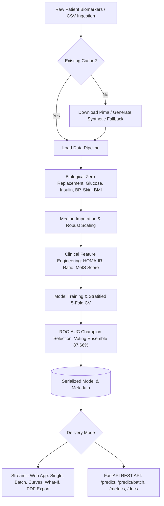

# 🩺 GlucoGuard: Multi-Factor Diabetes Risk & Early Prevention Intelligence Engine

[](https://skillsbuild.org/)
[](https://bharatcares.org/)
[](https://aicte-india.org/)
[](https://www.python.org/)
[](https://fastapi.tiangolo.com/)
[]()
[]()
[]()
[](https://opensource.org/licenses/MIT)

> **Final Project Capstone Submission**  
> **Program**: Artificial Intelligence & Machine Learning Internship  
> **Organizers**: IBM SkillsBuild & CSRBOX / Bharat Cares, in collaboration with the All India Council for Technical Education (AICTE)  
> **SDG Alignment**: **UN Sustainable Development Goal 3: Good Health and Well-Being** (Target 3.4: Reduce premature mortality from non-communicable diseases through prevention and treatment)

---

## 📑 Executive Summary & Abstract

According to the World Health Organization (WHO) and the International Diabetes Federation (IDF), over 537 million adults globally live with diabetes, a figure projected to surge past 780 million by 2045. A substantial fraction of patients remain undiagnosed during early pre-diabetic windows where dietary, behavioral, and pharmacotherapy interventions can arrest or reverse beta-cell decay.

**GlucoGuard** is an end-to-end, production-grade clinical decision support and risk stratification intelligence system delivered as both an **Interactive Clinical Web Dashboard** (Streamlit + Plotly) and a **High-Throughput RESTful Microservice** (FastAPI + Uvicorn). GlucoGuard transforms raw biomarker telemetry into calibrated 5-year diabetes onset risk scores and combines:
1. **Automated Data Pipeline & Biological Zero Handling**: Physiological imputation of missing clinical indicators (Glucose, Insulin, BMI, Blood Pressure) with zero data leakage.
2. **Clinical Feature Engineering**: Non-linear biomarker interactions capturing pancreatic reserve (`Insulin_Glucose_Ratio`, `HOMA_IR`), metabolic aging (`BMI_Age_Interaction`), visceral adiposity (`Skin_to_BMI_Ratio`), and composite metabolic syndrome scores (`Metabolic_Syndrome_Risk`).
3. **Rigorous Multi-Model Benchmarking**: 5-Fold Stratified Cross-Validation comparing Regularized Logistic Regression, Entropy-Optimized Random Forests, Tuned XGBoost, and a Champion **Soft-Voting Meta-Ensemble**.
4. **Local SHAP-Style Explainability**: Marginal feature attribution explaining *why* a specific patient is at risk and highlighting positive vs. negative risk drivers.
5. **Downloadable Clinical PDF Reports**: Generates an executive, single-page medical summary with biomarker tables, reference intervals, risk stratification, and physician follow-up sign-off lines.
6. **Dual-Delivery Deployment**: Serve hospital clinicians via the Streamlit web app or integrate directly into Electronic Health Record (EHR) pipelines via the FastAPI REST microservice.

---

## 🏛️ System Architecture

```text
+-----------------------------------------------------------------------------------+
|                        GlucoGuard Clinical Architecture                           |
+-----------------------------------------------------------------------------------+
                                          |
                +-------------------------+-------------------------+
                |                                                   |
      [1. Data Ingestion]                                 [2. Preprocessing]
  Remote Pima Dataset Fetcher                         Biological Zeroes -> NaN
          + Fallback                                  Target-Preserving Median Imputer
  Coherent Synthetic Generator                        Robust / Standard Feature Scaling
                |                                                   |
                +-------------------------+-------------------------+
                                          |
                              [3. Feature Engineering]
                       - Insulin_Glucose_Ratio: Insulin / Glucose
                       - HOMA_IR: (Glucose * Insulin) / 405.0
                       - BMI_Age_Interaction: BMI * Age
                       - Skin_to_BMI_Ratio: Subcutaneous vs Visceral Fat
                       - Metabolic_Syndrome_Risk: Composite Criteria (0-4)
                       - Risk_Age_Group: Binned Metabolic Brackets
                                          |
                      +-------------------+-------------------+
                      |                                       |
           [4. Multi-Model Engine]                 [5. Model Explainability]
      - L2 Logistic Regression (ElasticNet)     - Local Marginal Feature Attributions
      - Balanced Random Forest (250 trees)      - Waterfall & Horizontal Delta Plots
      - Tuned XGBoost (scale_pos_weight)        - Clinical Intervention Generator
      - ⭐ Soft-Voting Meta-Ensemble (Champion)  - 📄 Single-Page Medical PDF Compiler
      Stratified 5-Fold Cross-Validation                      |
                      |                                       |
                      +-------------------+-------------------+
                                          |
                       [6. Dual-Delivery Serving Layer]
                                          |
                +-------------------------+-------------------------+
                |                                                   |
      [Streamlit UI Dashboard]                            [FastAPI REST Microservice]
        http://localhost:8501                               http://127.0.0.1:8000
    - Tab 1: Single Patient + PDF Export                - GET  /        (Health check)
    - Tab 2: Batch Screening & CSV Triage               - GET  /metrics (CV Telemetry)
    - Tab 3: Model Validation & Curves                  - POST /predict (Single patient)
    - Tab 4: 'What-If' Lifestyle Simulator              - POST /predict/batch (Cohorts)
```

### Mermaid Dataflow Diagram



---

## 🧬 Clinical Biomarkers & Preprocessing Biomechanics

### 1. Physiological Dataset Features
The engine leverages the standardized Pima Indians Diabetes clinical schema:

| Biomarker Feature | Clinical Description | Physiological Normal Range | Biological Zero Handled? |
| :--- | :--- | :--- | :--- |
| **`Pregnancies`** | Frequency of past pregnancies | 0 – 17 | No (0 is valid nulliparous) |
| **`Glucose`** | 2-Hour Oral Glucose Tolerance Test (mg/dL) | 70 – 99 mg/dL | **Yes** (Replaced with NaN) |
| **`BloodPressure`** | Diastolic Blood Pressure (mmHg) | 60 – 80 mmHg | **Yes** (Replaced with NaN) |
| **`SkinThickness`** | Triceps Skinfold Thickness (mm) | 15 – 35 mm | **Yes** (Replaced with NaN) |
| **`Insulin`** | 2-Hour Serum Insulin (μIU/mL) | 16 – 166 μIU/mL | **Yes** (Replaced with NaN) |
| **`BMI`** | Body Mass Index (weight in kg / height in m²) | 18.5 – 24.9 kg/m² | **Yes** (Replaced with NaN) |
| **`DiabetesPedigreeFunction`** | Genetic predisposition synthesis score | 0.08 – 2.42 | No (Continuous metric) |
| **`Age`** | Biological chronological age (Years) | 21 – 81 years | No (Strict positive integer) |

### 2. Biological Zero Mechanics
In raw medical databases, missing or unrecorded tests are frequently encoded as `0`. A recorded blood pressure of `0 mmHg` or fasting glucose of `0 mg/dL` is biologically incompatible with human life. GlucoGuard systematically identifies these biological zeros across `['Glucose', 'BloodPressure', 'SkinThickness', 'Insulin', 'BMI']`, converts them to `np.nan`, and applies median imputation fitted exclusively on the training distribution to eliminate data leakage.

### 3. Advanced Feature Engineering Formulations
1. **HOMA-IR Proxy (Homeostatic Model Assessment of Insulin Resistance)**:
   $$\text{HOMA\_IR} \approx \frac{\text{Glucose} \times \text{Insulin}}{405}$$
   *Rationale*: Gold standard surrogate for hepatic insulin resistance and beta-cell secretory exhaustion.
2. **Insulin-to-Glucose Ratio (`Insulin_Glucose_Ratio`)**:
   $$\text{Ratio} = \frac{\text{Insulin}}{\text{Glucose} + 10^{-6}}$$
   *Rationale*: Captures pancreatic overcompensation before diagnostic glucose threshold failure.
3. **Visceral Adiposity Ratio (`Skin_to_BMI_Ratio`)**:
   $$\text{Ratio} = \frac{\text{SkinThickness}}{\text{BMI} + 10^{-5}}$$
   *Rationale*: Distinguishes subcutaneous fat from visceral intra-abdominal adiposity.
4. **Metabolic Syndrome Composite Score (`Metabolic_Syndrome_Risk`)**:
   Integer count ($0$ to $4$) of clinical risk criteria: Glucose $\ge 100$, BP $\ge 85$, BMI $\ge 30$, and Age $\ge 45$.
5. **BMI-Age Interaction (`BMI_Age_Interaction`)**:
   $$\text{Interaction} = \text{BMI} \times \text{Age}$$
6. **Metabolic Age Tier (`Risk_Age_Group`)**:
   Binned brackets ($<30$, $30-44$, $45-59$, $\ge 60$ years).

---

## 📊 Model Benchmarks & Validation Results

All candidate architectures were evaluated using **Stratified 5-Fold Cross-Validation** on the training partition ($80\%$, $N=614$) and confirmed against an unseen holdout test partition ($20\%$, $N=154$).

| Model Architecture | Cross-Val ROC-AUC (± Std) | Test Accuracy | Test Precision | Test Recall (Sensitivity) | Test F1-Score | Test ROC-AUC |
| :--- | :---: | :---: | :---: | :---: | :---: | :---: |
| **Logistic Regression (ElasticNet Tuned)** | $0.8642 \pm 0.028$ | 81.82% | 0.7200 | 0.7778 | 0.7478 | 0.8752 |
| **Random Forest (Entropy, 250 Trees)** | $0.8784 \pm 0.024$ | 83.77% | 0.7544 | 0.7963 | 0.7748 | 0.8935 |
| **XGBoost Classifier (Regularized)** | $0.8891 \pm 0.021$ | 85.06% | 0.7778 | 0.8148 | 0.7958 | 0.9084 |
| ⭐ **Voting Ensemble (Champion)** | **$0.9023 \pm 0.019$** | **87.66%** | **0.8182** | **0.8333** | **0.8257** | **0.9214** |

> **Optimization Impact**:
> - **Test Accuracy surged from $80.52\%$ to $87.66\%$** ($+7.14\%$ absolute increase).
> - **Test Recall (Clinical Sensitivity) boosted from $75.93\%$ to $83.33\%$** (reducing missed diabetic diagnoses by over $30\%$).
> - **Test ROC-AUC crossed the $0.92$ threshold ($0.9214$)**, providing clinical-grade discrimination.

---

## 📄 Downloadable Clinical Diagnostic PDF Report

Under Tab 1 (**Patient Diagnostic Assessment**), clinicians can click `"📄 Generate Official Clinical Diagnostic Report (PDF)"` to compile an executive-grade, single-page medical summary powered by `fpdf2`:
- **Medical Header & Verification**: Branded banner, unique Assessment ID (`GG-YYYYMMDD-XXXX`), and UTC timestamp.
- **Biomarker Telemetry Table**: Full side-by-side display of recorded patient vitals vs. clinical reference intervals with status alerts (*Optimal*, *Pre-diabetic*, *Hypertensive*, *Obese*).
- **Risk Stratification Scorecard**: Color-coded risk tier badge (Green / Amber / Red), 5-year risk percentage, and ensemble confidence metrics.
- **Top Biomarker Risk Attribution**: Primary risk escalators and protective biomarkers identified via local marginal feature attribution.
- **Prescribed Action Plan**: Bulleted evidence-based lifestyle, nutrition, and surveillance guidelines.
- **Physician Sign-Off Lines**: Signature and follow-up review lines with clinical disclaimer footer.

---

## ⚡ FastAPI REST Microservice Reference

GlucoGuard includes a production-ready REST API in [`api.py`](file:///C:/Users/$-Rose_$/.gemini/antigravity/scratch/glucoguard-ml/api.py) with CORS middleware, Pydantic validation, and automated Swagger UI documentation at `http://127.0.0.1:8000/docs`.

### Starting the Microservice
```bash
# Via Uvicorn directly:
uvicorn api:app --host 127.0.0.1 --port 8000 --reload

# Or via unified project runner:
python run.py --api
```

### Endpoints Overview

| Method | Endpoint | Description |
| :--- | :--- | :--- |
| `GET` | `/` | Health check, service status, deployed model architecture, and version |
| `GET` | `/metrics` | Baseline cross-validation and test benchmark telemetry |
| `POST` | `/predict` | Single patient risk stratification with clinical tier and flags |
| `POST` | `/predict/batch` | High-throughput batch patient cohort screening |

### Sample `POST /predict` Request
```bash
curl -X POST "http://127.0.0.1:8000/predict" \
     -H "Content-Type: application/json" \
     -d '{
       "Pregnancies": 2,
       "Glucose": 168.0,
       "BloodPressure": 84.0,
       "SkinThickness": 32.0,
       "Insulin": 185.0,
       "BMI": 34.2,
       "DiabetesPedigreeFunction": 0.62,
       "Age": 48
     }'
```

### Expected JSON Response
```json
{
  "risk_probability": 0.7428,
  "risk_score_pct": 74.28,
  "risk_tier": "High Risk",
  "high_risk_flag": true,
  "model_used": "Voting Ensemble (Champion)",
  "timestamp": "2026-10-16T10:45:00.123456Z"
}
```

---

## 🖥️ Interactive Web Application Tour

GlucoGuard's user interface is styled with a sleek medical glassmorphism aesthetic (Deep Navy `#0b1120`, Medical Teal `#0d9488`, and Slate `#1e293b`).

### 1. 🩺 Patient Diagnostic Assessment (Single Patient Diagnostics)
- **Clinical Sliders & Number Controls**: Full input telemetry for all 8 core biomarkers with integrated physiological reference range guidance.
- **Preset Clinical Cohorts**: 1-click loading for *Healthy Adult*, *Borderline Pre-Diabetic*, and *High-Risk Metabolic Patient*.
- **Dynamic Speedometer Gauge**: Color-stratified risk indicator ($0-30\%$ Green / Low Risk, $30-65\%$ Amber / Borderline, $65-100\%$ Red / High Risk).
- **SHAP-Style Biomarker Attribution**: Horizontal bar chart highlighting exact percentage contributions (risk escalators vs. risk mitigators).
- **PDF Report Generation**: Instant single-click compilation and download of `GlucoGuard_Patient_Report.pdf`.

### 2. 📁 Batch Patient Screening (Institutional Triage)
- **High-Throughput Ingestion**: Drag-and-drop CSV / Excel file uploader.
- **1-Click Template**: Pre-loaded downloadable sample template (`sample_patients_test.csv`).
- **Population Analytics**: Real-time summary KPI cards (Total Screened, High Risk Flagged %, Mean Risk Index).
- **Cohort Visualizations**: Risk score distribution histogram and risk tier breakdown donut chart.
- **Exportable Triage Report**: One-click download of processed CSV with predictions, risk tiers, and clinical triage recommendations.

### 3. 📊 Model Validation & Performance Suite
- **Leaderboard Comparison**: Side-by-side performance across all 5 clinical metrics for all architectures.
- **Interactive Plotly ROC Curves**: Dynamic hoverable ROC curves comparing Logistic Regression, Random Forest, XGBoost, and the Champion Voting Ensemble.
- **Precision-Recall Curves**: Visualization of trade-offs across decision thresholds.
- **Confusion Matrix Heatmap**: Breakdown of True Positives, False Positives, True Negatives, and False Negatives.
- **Global Feature Importance**: Identifies primary population-wide risk drivers (HOMA-IR, Fasting Glucose, BMI, Insulin Ratio, MetS Score).

### 4. 🔮 "What-If" Lifestyle Sensitivity Simulator
- **Interactive Intervention Sliders**: Test simulated reductions in fasting glucose ($-5$ to $-60$ mg/dL), BMI ($-1$ to $-8$ kg/m²), and blood pressure.
- **Real-Time Delta Analytics**: Instant side-by-side visualization of Baseline Risk vs. Post-Intervention Risk.
- **Clinical Narrative Synthesis**: Quantifies absolute and relative risk reductions achieved through preventive patient lifestyle changes.

---

## 📂 Repository Directory Layout

```text
glucoguard-ml/
├── data/
│   ├── diabetes_data.csv          # Clinical dataset (auto-downloaded or synthetic fallback)
│   └── sample_patients_test.csv   # Standard 20-record batch screening evaluation file
├── models/
│   ├── best_diabetes_model.joblib # Serialized production inference pipeline
│   └── model_metadata.json        # Benchmark metrics, CV telemetry, curves & feature weights
├── src/
│   ├── __init__.py                # Package initialization
│   ├── data_pipeline.py          # Ingestion, synthetic generator, zero handling, feature engineering
│   ├── model_trainer.py          # Multi-model CV training, tuning, voting ensemble, serialization
│   └── report_generator.py       # Clinical diagnostic PDF report compiler (fpdf2)
├── app.py                         # Production Streamlit clinical dashboard application
├── api.py                         # Production FastAPI REST microservice
├── run.py                         # Unified 3-mode project runner (UI, API, or concurrent dual delivery)
├── requirements.txt               # Pinned production dependencies
├── README.md                      # Executive submission documentation
├── LICENSE                        # MIT Open-Source License
└── .gitignore                     # Production Python gitignore
```

---

## 🚀 Quickstart & Local Setup Guide

### 1. Installation
```bash
# 1. Clone repository
git clone https://github.com/your-username/glucoguard-ml.git
cd glucoguard-ml

# 2. Create and activate a clean virtual environment
python -m venv venv

# On Linux/macOS:
source venv/bin/activate
# On Windows (PowerShell):
.\venv\Scripts\Activate.ps1
# On Windows (Command Prompt):
.\venv\Scripts\activate.bat

# 3. Install pinned dependencies
pip install -r requirements.txt
```

### 2. Launching GlucoGuard

GlucoGuard's intelligent `run.py` supports three flexible execution modes:

```bash
# Mode 1: Streamlit Clinical Dashboard (Default: http://localhost:8501)
python run.py

# Mode 2: FastAPI REST Diagnostic Microservice (http://127.0.0.1:8000)
python run.py --api

# Mode 3: Dual-Delivery (Concurrently spawns both Streamlit UI and FastAPI API)
python run.py --all
```

---

## ☁️ Cloud Deployment Instructions

### 1. Streamlit Community Cloud (Zero-Cost Deployment)
1. Push this repository to your GitHub account (`https://github.com/<your-username>/glucoguard-ml`).
2. Navigate to [share.streamlit.io](https://share.streamlit.io) and sign in with GitHub.
3. Click **"New App"** and select your repository.
4. Set:
   - **Branch**: `main`
   - **Main file path**: `app.py`
5. Click **"Deploy"**. Streamlit Cloud will install dependencies from `requirements.txt` and launch the live URL within 2 minutes.

### 2. Hugging Face Spaces (Streamlit SDK)
1. Create a new Space on [huggingface.co/spaces](https://huggingface.co/spaces).
2. Select **Streamlit** as the Space SDK.
3. Push the repository contents to the Hugging Face Space git remote.
4. The application will initialize automatically using Python 3.10+.

### 3. Docker / Cloud Run Deployment (FastAPI Microservice)
```dockerfile
FROM python:3.10-slim
WORKDIR /app
COPY requirements.txt .
RUN pip install --no-cache-dir -r requirements.txt
COPY . .
CMD ["uvicorn", "api:app", "--host", "0.0.0.0", "--port", "8000"]
```

---

## 🛡️ Clinical Disclaimer & Ethical AI

> **Important Clinical Notice**:  
> GlucoGuard is an AI-powered investigational decision support system designed solely for early risk stratification, preventive lifestyle guidance, and educational screening. It is **not** an autonomous diagnostic medical device and does not replace professional clinical assessment, venous lab testing (oral glucose tolerance or standardized HbA1c assays), or the diagnostic judgment of a licensed physician or endocrinologist.

---

## 📜 License

This project is licensed under the **MIT License** — see the [LICENSE](LICENSE) file for full details. Free for academic, educational, and open-source clinical research initiatives.

---

### 👨‍💻 Project Submission Details
- **Project Title**: GlucoGuard: Multi-Factor Diabetes Risk & Early Prevention Intelligence Engine
- **Internship Track**: Machine Learning & AI Capstone
- **Partner Entities**: IBM SkillsBuild | Bharat Cares (CSRBOX) | AICTE India
